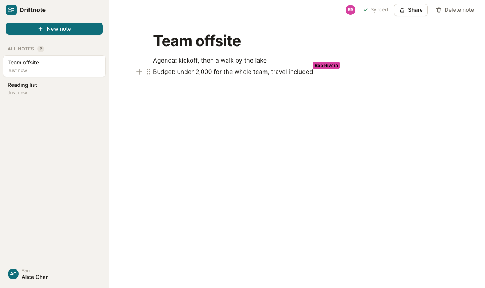
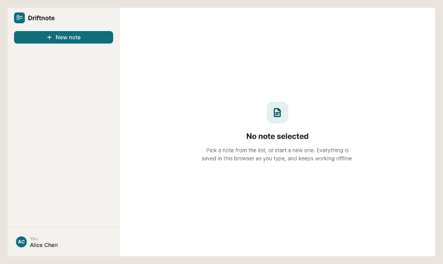
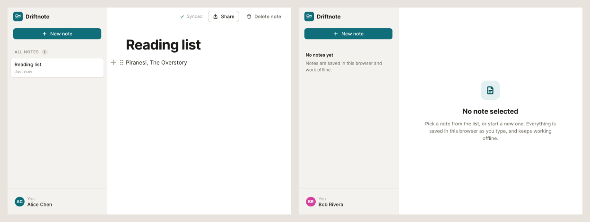

<p align="center">
  
</p>

<h1 align="center">Driftnote</h1>

<p align="center">
  A local-first, real-time collaborative notes app.<br />
  It works fully offline, syncs when the connection returns, and merges everyone's edits
  without conflicts.
</p>

<p align="center">
  <picture>
    <source media="(prefers-color-scheme: dark)" srcset="docs/media/app-dark.png" />
    
  </picture>
</p>

> **Status:** offline-first editing (milestone M1) and real-time collaboration (M2) are
> done. Next: offline conflict handling (M3). This is a learning project, built one
> test-first task at a time; see [`docs/PROGRESS.md`](docs/PROGRESS.md).

## What it does

### Works offline, really

Notes live in your browser first. Close the laptop, lose the Wi-Fi, reload the page: the
app and your notes are still there. Changes made offline are marked **Not backed up**
and sync on their own when the connection returns.

<p align="center">
  
</p>

### Real-time collaboration

Share a link and edit together. Everyone sees everyone's changes as they happen, with
named, coloured cursors. Two people typing at the same moment never overwrite each
other: edits are merged by a CRDT (Yjs), not by "last write wins".

<p align="center">
  
</p>

### And also

- **Share links with a role:** *can edit* or *can view*. Revoke a link and anyone using it
  is disconnected immediately. View links get a read-only editor; the server drops any
  change they send.
- **Honest status:** a quiet badge says **Offline**, **Syncing…** or **Synced**. "Synced"
  means the server has written your change to disk and confirmed it, not merely that it
  was sent.
- **Notes from the future stay safe:** a note saved by a newer version of the app opens
  read-only instead of being damaged.
- **Two tabs, no server needed:** tabs of the same note stay in step even offline.
- **Light and dark, desktop and phone,** following your system settings.
- **Security basics:** a strict Content Security Policy (no inline scripts), tokens
  stored only as hashes on the server, unsafe links (`javascript:` and friends) never
  clickable, size and rate limits on the sync server.

**Privacy, plainly:** notes are stored unencrypted on the sync server, so whoever runs
the server can read synced notes. End-to-end encryption is a possible later exploration.

## How it works

```
 Browser (React + BlockNote editor)                     Sync server (Node)
 ┌──────────────────────────────────────┐              ┌──────────────────────────────┐
 │ one Yjs document per note (a CRDT)   │  WebSocket   │ one in-memory "room" per     │
 │   ↕ saved locally in IndexedDB       │◄────────────►│ open note: relays changes,   │
 │   ↕ other tabs via BroadcastChannel  │  /sync/<id>  │ checks the link's role,      │
 │ service worker: the app works offline│              │ saves to SQLite, then sends  │
 │                                      │  REST /api   │ an "ack" covering your edits │
 │ share dialog ────────────────────────┼─────────────►│ share links: create/list/    │
 └──────────────────────────────────────┘              │ revoke (tokens stored hashed)│
                                                       └──────────────────────────────┘
```

- **Local-first:** every change is applied to the note's Yjs document in the browser and
  saved to IndexedDB before anything goes over the network.
- **Conflict-free merging:** Yjs is a CRDT. Each replica can accept edits independently,
  and any two replicas that have seen the same changes end up identical, in whatever
  order those changes arrived.
- **Capability links:** a share link is `/n/<note>#t=<token>`. The part after `#` never
  leaves the browser in HTTP requests, so tokens stay out of server logs; the app also
  removes it from the address bar.
- **Acknowledged saves:** the server answers a durable save with a Yjs snapshot (what it
  stored, including deletions); the browser compares it with its own document to decide
  between "Syncing…" and "Synced".

The full design is in [`docs/ARCHITECTURE.md`](docs/ARCHITECTURE.md), and every
significant decision has a short record with its reasons in [`docs/adr/`](docs/adr/).

## Built with

| Part | Choice |
|---|---|
| Language | TypeScript (strict), in a pnpm workspace |
| Browser | React 19, Vite 8, [BlockNote](https://www.blocknotejs.org/) editor, `vite-plugin-pwa` (offline shell) |
| Sync | [Yjs](https://yjs.dev/) CRDT, `y-websocket` (client), `y-indexeddb` (local storage) |
| Server | Node 26, `ws` (WebSockets), SQLite via `better-sqlite3` |
| Tests | Vitest (integration and unit), Playwright (end-to-end in Chromium, Firefox and WebKit) |

## How it is tested

Every task was built test-first: write the test, watch it fail for the right reason,
make it pass, then check the test can catch a regression by deliberately breaking the
code ("sabotage checks").

- **88 integration and unit tests** run the real sync server with real WebSocket clients
  and a real SQLite file: syncing, saving, acknowledgements, link roles, limits, presence,
  security headers.
- **40 end-to-end tests**, each run in **Chromium, Firefox and WebKit**: real browsers
  driving the real app, often as two people at once (offline reloads, sharing, live
  cursors, read-only links, two tabs offline).

```sh
pnpm check      # lint, format, typecheck, integration + unit tests, end-to-end (Chromium)
pnpm e2e:all    # end-to-end tests in all three browsers
```

## Run it locally

Prerequisites: [nvm](https://github.com/nvm-sh/nvm) and pnpm 12
(`npm install -g pnpm@12`).

```sh
nvm install && nvm use   # Node version from .nvmrc
pnpm install
pnpm dev                 # web app on http://localhost:5173, sync server on :4000
```

For the end-to-end tests, install the browsers once:

```sh
pnpm --filter @driftnote/web exec playwright install chromium firefox webkit
```

Other commands: `pnpm lint`, `pnpm format:check`, `pnpm typecheck`, `pnpm test`,
`pnpm test:int`, `pnpm e2e`, `pnpm shots` (screenshots of every screen for design
review), `pnpm demo` (re-records the GIFs and images in this README).

## Roadmap

| Milestone | What | State |
|---|---|---|
| M0 | Project setup, checks | done |
| M1 | Offline-first editor | done |
| M2 | Real-time collaboration and sharing | done |
| M3 | Offline conflict handling: concurrent offline edits, "delete for everyone" | next |
| M4 | Version history with restore | planned |
| M5 | Accessibility and performance | planned |
| CI | Automated checks on every push | planned |

## Repository layout

| Path | What |
|---|---|
| `apps/web` | Browser app (React + Vite); end-to-end tests in `e2e/` |
| `apps/sync-server` | Hand-built Yjs sync server (Node); integration tests in `test/` |
| `packages/shared` | Code used by both (protocol constants, note IDs, tokens, the `ack` check) |
| `docs/` | Architecture, decisions, design system, plan, progress, learning log |

## Docs

- [Project brief](PROJECT_BRIEF.md): goals and features
- [Architecture](docs/ARCHITECTURE.md): the system design, explained
- [Decision records](docs/adr/): every significant choice and why
- [Design system](docs/DESIGN.md): how the UI is built and reviewed
- [Execution plan](docs/EXECUTION_PLAN.md) and [progress](docs/PROGRESS.md)
- [Learning log](docs/LEARNING_LOG.md): what went wrong, what I learned
