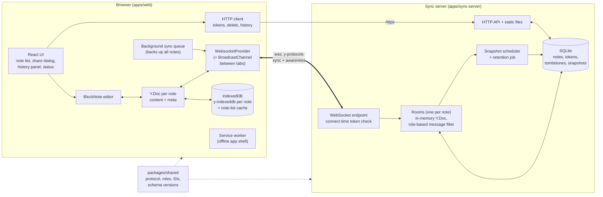

# Driftnote architecture

A local-first collaborative notes app. Every note is a Yjs CRDT document that lives in the
browser first, is persisted locally, and syncs through a small hand-built WebSocket server
that also stores backups and version history.

## Decisions

| ADR | Topic | Decision | Status |
|---|---|---|---|
| [001](adr/001-crdt-library.md) | CRDT library | Yjs | Accepted |
| [002](adr/002-document-model.md) | Document model | One `Y.Doc` per note; local, rebuildable note-list cache | Accepted |
| [003](adr/003-editor.md) | Editor | BlockNote (core only), no media blocks | Accepted |
| [004](adr/004-local-storage.md) | Local storage | `y-indexeddb` + `idb` note list; request persistent storage | Accepted |
| [005](adr/005-sync-topology.md) | Sync topology | Hand-built Node relay server, `y-protocols` wire format; all notes sync | Accepted |
| [006](adr/006-sharing-and-identity.md) | Sharing and identity | Note ID + hashed role tokens (owner/edit/view); recovery deferred | Accepted |
| [007](adr/007-version-history.md) | Version history | Server-side full-state snapshots; forward restore; named versions | Accepted |
| [008](adr/008-toolchain-and-monorepo.md) | Toolchain | pnpm workspaces, strict TS, ESLint + Prettier, Vite + React, PWA shell | Proposed |
| [009](adr/009-testing-strategy.md) | Testing | Unit, CRDT property tests, server integration, Playwright e2e | Proposed |
| [010](adr/010-deployment-and-hosting.md) | Deployment | Local until needed; then one container + volume, single origin | Proposed |
| [011](adr/011-security-and-privacy.md) | Security and privacy | Baseline hardening; E2EE as M6 exploration | Proposed |
| [012](adr/012-schema-evolution.md) | Schema evolution | Additive-only + version gates; copy-on-migrate escape hatch | Proposed |

## Components

### Browser (`apps/web`)
- **Service worker:** precaches the app shell so the app loads with no network (ADR 008).
- **BlockNote editor:** bound to the note's `Y.XmlFragment`; read-only for `view` role or
  outdated schema (ADR 003, 006, 012).
- **`Y.Doc` per note:** `content` (rich text) and `meta` (`title`, `createdAt`,
  `schemaVersion`) (ADR 002).
- **IndexedDB:** `y-indexeddb` persists each note doc; an `idb` store holds the note-list
  cache and tokens (ADR 004, 006).
- **WebsocketProvider:** stock `y-websocket` client; syncs the open note and relays
  presence; keeps tabs in sync via `BroadcastChannel` (ADR 005).
- **Background sync queue:** syncs unopened notes a few at a time so every note is backed
  up (ADR 005).
- **HTTP client:** share-token management, delete, history list/fetch (ADR 006, 007).

### Server (`apps/sync-server`)
- **WebSocket endpoint:** checks tombstone and token hash before any sync; tags each
  connection with `{ noteId, tokenId, role }` (ADR 006).
- **Rooms:** one in-memory `Y.Doc` per active note; applies and relays updates; drops
  sync step 2 and update messages from `view` connections; relays awareness (ADR 005, 006).
- **SQLite:** compacted note state, token hashes, deletion tombstones, snapshots.
- **Snapshot scheduler:** at most every 10 minutes while edited and when a room empties;
  retention pruning (ADR 007).
- **HTTP API + static files:** single origin for app, API and WebSocket (ADR 010).

### Shared (`packages/shared`)
Environment-neutral TypeScript: message/close codes, role types, ID generation, protocol
and schema version constants.

## Key data flows

**1. Create and edit a note offline**
Browser generates `noteId` and `ownerToken` → creates `Y.Doc` → BlockNote edits produce Yjs
updates → `y-indexeddb` stores them → note-list cache updated from `meta`. No network needed.

**2. First sync (claiming the note)**
Online → provider connects with `?note=<id>&t=<ownerToken>` → server finds unknown note and
registers the token hash as `owner` → sync step 1/2 exchange → server persists state.

**3. Share and join**
Owner `POST /notes/:id/tokens {role}` → server returns a token once, stores its hash →
link `/n/<id>#t=<token>` → recipient's app reads and scrubs the fragment, stores the token,
connects → server resolves role → live sync and presence.

**4. Offline merge**
Two users edit while disconnected → on reconnect each exchanges state vectors with the
server → each receives exactly the missing updates → CRDT merge preserves both edits.

**5. View-only enforcement**
Server allows sync step 1 and awareness from `view` connections, drops sync step 2 and
updates; viewers still receive all outgoing updates.

**6. Revoke**
Owner `DELETE /notes/:id/tokens/:tokenId` → `revoked_at` set → live sockets using that
token are closed → future connects rejected.

**7. Version history and restore**
Server snapshots full state → client lists snapshots over HTTP (owner/edit only) → preview
in a temporary `Y.Doc` and read-only editor → restore: server stores a `pre-restore`
snapshot, client replaces live blocks via BlockNote → forward edit syncs to everyone.

**8. Delete**
Owner `DELETE /notes/:id` → server removes data, tokens and snapshots, writes a tombstone →
reconnecting stale replicas are refused and told the note was deleted.

## Connection status (brief feature 6)
Derived from provider events and exposed in the DOM as `data-sync-state`:
`offline` (no socket), `syncing` (connected, initial exchange or local changes not yet
acknowledged), `synced` (connected and up to date).

## Known trade-offs and open questions
- The server can read all notes (every note syncs in plaintext). E2EE is an M6 exploration
  that would require new ADRs.
- Recovery is deferred: a wiped browser loses its note list and owner tokens (ADR 006).
- Version history is unavailable offline (ADR 007).
- Single server instance; no horizontal scaling (ADR 010).
- To verify during implementation: BlockNote's handling of unknown block types (ADR 012),
  Playwright offline emulation of WebSockets per browser (ADR 009), `node:sqlite`
  stability in the chosen Node LTS (ADR 008).
